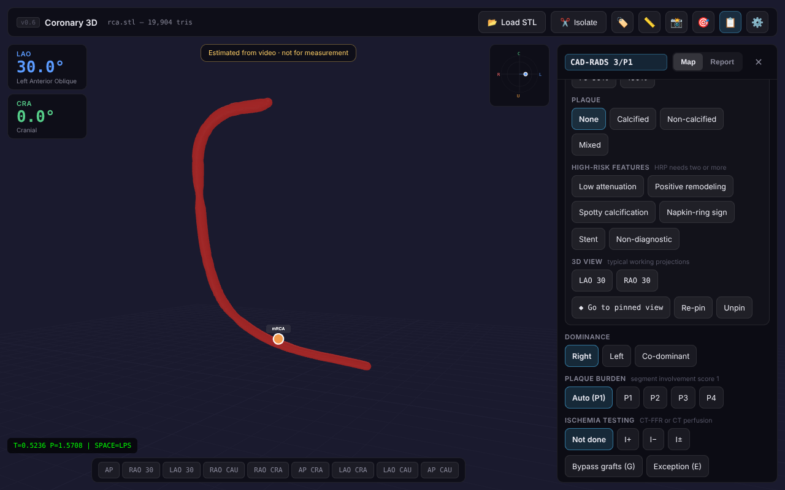
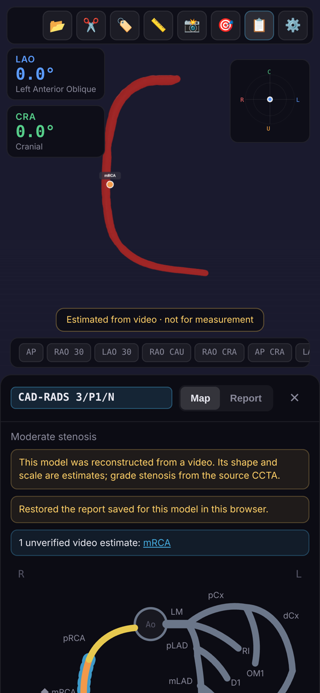

# CathVision-3D

A browser viewer for 3D coronary artery models. Load an STL and look at it from fluoroscopy angles —
RAO/LAO and cranial/caudal, as on a C-arm — on a desktop or a phone.

> An education and visualisation tool. It is not a medical device and makes no diagnosis.



## What it does

- **Angiographic views.** Drag to orbit; the HUD reads the projection as a cath lab would (LAO 30 /
  CRA 20). Nine standard presets. Models open in AP with the patient's right on your left.
- **Correct orientation.** Reads the coordinate space 3D Slicer writes into the STL header
  (`SPACE=LPS` or `SPACE=RAS`) and orients the model accordingly. Settings → **Flip R/L** covers
  files with no tag.
- **Labels and measurements** on the model surface, in millimetres.
- **Isolate** the largest connected component (aorta and coronary tree) from a noisy segmentation.
- **CAD-RADS report, linked to the model** (clipboard button). Enter each segment's findings on a
  coronary map; the app derives the CAD-RADS 2.0 classification and a structured text report. Each
  segment offers its typical working projections, and can be **pinned** to a spot on the model
  together with the view you were looking from, so one tap brings you back to it.
- **Video to model** ([tools/video2stl](tools/video2stl/README.md)). A Python tool that turns an
  axial-sweep CCTA video into an STL and a findings file the report panel imports as unverified
  suggestions. Estimated geometry, for teaching.



## Where the numbers come from

The report panel does bookkeeping. **You** grade each segment from the source CCTA; the app applies
the CAD-RADS 2.0 rules and formats the result. It never grades stenosis from the mesh — a surface
model is a thresholded rendering and cannot support that.

Findings imported from `tools/video2stl` are estimates from a compressed video with an assumed scale.
They arrive as suggestions, are marked as such, and do not change the classification until you
accept them. Models made that way carry a standing "estimated" notice.

## Run it

```bash
npm install
npm run dev        # http://localhost:5173
```

## Test it

```bash
npm test                                                             # angle maths, STL orientation, CAD-RADS rules
python -m unittest discover -s tools/video2stl -p "test_*.py"        # video pipeline against a phantom
node scripts/e2e-report.mjs --stl model.stl --findings findings.json # the app in Chromium, mouse and touch
```

The last two need extra tooling (Python packages and ffmpeg; Playwright); see
[tools/video2stl/README.md](tools/video2stl/README.md) and the header of `scripts/e2e-report.mjs`.

## Stack

React 18, Vite, Three.js. No backend: files are read in the browser and nothing is uploaded.
Reports are saved in the browser's local storage, per model.

Created by Avinainder Singh, co-created with Claude (Anthropic).
